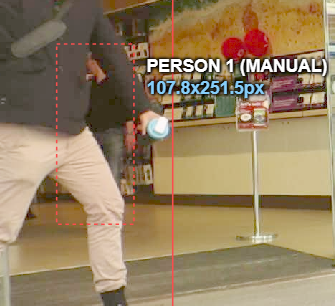
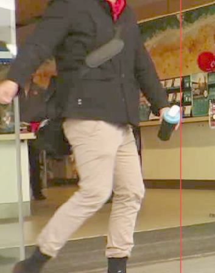
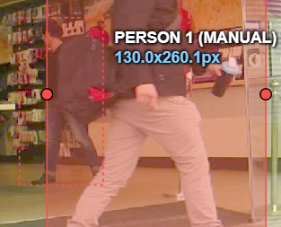

# Báo cáo cá nhân — HoVaTen-MSSV

Đổi tên file theo quy tắc `MSSV_HoTen.md`. Ví dụ: `20241234_NguyenVanAn.md`.

Đoạn video: MOT17-09, 150 frame (frame 1–150), nguồn MOTChallenge, giấy phép CC BY-NC-SA 3.0.

## 0. Thông tin học viên

- Họ tên: Trịnh Đức Hưng
- MSSV: 2A202603177
- Mã đề (A/B/C): C
- Email: hungductrinh2004@gmail.com
- Link repository: https://github.com/HungReaper/K5-L2A-DAY05-TrinhDucHung-2A202603177-MOTTracking
- Giờ bắt đầu: 16h15
- Giờ kết thúc: 18h10

## 1. Xem trước đoạn video (CP0)

Ghi **trước khi vẽ**, mỗi người một dòng.

| Mã  | Frame xuất hiện | Frame cuối thấy được | Rẽ / dừng / đổi tốc độ ở frame | Bị che ở frame | Ghi chú |
| --- | --------------- | -------------------- | ------------------------------ | -------------- | ------- |
| P1  | 0               | 149                  | 19                             | 41             |         |
| P2  | 61              | 149                  | 75                             |                |         |
| P3  | 40              | 149                  |                                |                |         |
| P4  | 2               | 107                  | 35                             | 107            |         |
| P5  | 28              | 129                  |                                | 120, 135       |         |

## 2. Keyframe và thời gian (CP1, CP4)

Số keyframe lấy từ kết quả `src/check_submission.py`.

| Mã       | Số keyframe | Keyframe ở frame                                                                                                                                                                                                                                                                                                                                                                                                                                            | Số frame có mặt | Keyframe / 100 frame | Thời gian (phút) | Chỗ khó |
| -------- | ----------- | ----------------------------------------------------------------------------------------------------------------------------------------------------------------------------------------------------------------------------------------------------------------------------------------------------------------------------------------------------------------------------------------------------------------------------------------------------------- | --------------- | -------------------- | ---------------- | ------- |
| P1       | 104         | [0, 3, 4, 5, 6, 7, 9, 10, 11, 12, 13, 14, 15, 16, 17, 18, 19, 20, 21, 22, 26, 30, 38, 39, 40, 50, 51, 52, 53, 54, 55, 56, 57, 60, 61, 62, 63, 64, 65, 66, 67, 69, 70, 71, 72, 73, 74, 75, 76, 77, 78, 79, 80, 82, 83, 85, 86, 87, 88, 89, 90, 91, 92, 93, 95, 96, 97, 98, 99, 100, 101, 102, 105, 106, 107, 110, 111, 112, 113, 116, 117, 120, 121, 122, 123, 124, 125, 126, 129, 130, 131,132, 133, 134, 135, 138, 140, 142, 143, 144, 145, 147, 148, 149] | 141             | 73.8                 |                  |         |
| P2       | 71          | [61, 65, 67, 68, 69, 71, 73, 74, 75, 76, 77, 78, 79, 80, 81, 82, 83, 84, 85, 86, 87, 88, 89, 90, 91, 92, 94, 96, 97, 98, 100, 101, 102, 103, 104, 105, 106, 107, 108, 109, 111, 112, 116, 117, 118, 119, 120, 121, 122, 124, 125, 126, 127, 128, 129, 130, 131, 132, 133, 137, 139, 140, 141, 142, 143, 144, 145, 146, 147, 148, 149]                                                                                                                       | 89              | 79.8                 |                  |         |
| P3       | 75          | [40, 42, 43, 45, 50, 52, 53, 54, 55, 56, 58, 60, 64, 65, 66, 68, 69, 70, 72, 74, 75, 76, 77, 80, 84, 85, 87, 88, 89, 90, 91, 92, 93, 94, 95, 96, 99, 100, 101, 102, 103, 104, 105, 106, 107, 110, 111, 112, 113, 115, 117, 119, 120, 122, 123, 124, 125, 126, 127, 128, 129, 130, 131, 132, 133, 134, 137, 139, 140, 141, 142, 143, 144, 145, 149]                                                                                                          | 110             | 68.2                 |                  |         |
| P4       | 9           | [2, 7, 12, 17, 22, 32, 37, 42, 47]                                                                                                                                                                                                                                                                                                                                                                                                                          | 105             | 8.6                  |                  |         |
| P5       | 83          | [28, 29, 33, 34, 35, 36, 37, 38, 39, 40, 41, 42, 43, 44, 45, 46, 48, 49, 50, 51, 52, 53, 54, 55, 56, 57, 58, 59, 60, 61, 62, 63, 64, 65, 66, 67, 68, 73, 74, 75, 76, 77, 78, 79, 80, 81, 82, 83, 84, 85, 87, 88, 89, 90, 91, 93, 94, 95, 97, 98, 99, 100, 102, 103, 104, 105, 106, 108, 109, 110, 111, 112, 113, 114, 115, 116, 117, 118, 119, 129, 130, 131, 132]                                                                                          | 97              | 85.6                 |                  |         |
| **Tổng** | 342         |                                                                                                                                                                                                                                                                                                                                                                                                                                                             | 542             | 63.1                 |                  |         |

Keyframe / 100 frame của cả bài = tổng keyframe ÷ tổng số frame có mặt × 100 = 63.1

Bạn đặt keyframe nhiều nhất ở người nào? Vì sao (người đó rẽ, dừng, lại gần camera hay bị che)?

`P1` vì người đó xuất hiện từ frame đầu đến frame cuối.

## 3. Đoạn bị che (CP2)

Người bị che: `P1`

| Mốc                                      | Frame |
| ---------------------------------------- | ----: |
| Bắt đầu bị che một phần (bật `occluded`) |    26 |
| Mất hẳn (bật `outside`)                  |    41 |
| Hiện lại (tắt `outside`)                 |    50 |
| Thấy rõ trở lại (tắt `occluded`)         |    55 |

- Thời gian khuất hẳn: 9 frame = 270 giây.
- Quyết định: giữ cùng ID.
- Lý do (trả lời 3 câu: khuất bao lâu so với 60 frame, ngoại hình có khớp, chỗ hiện lại có đúng hướng và tốc độ):
	- khuất 9 frame so với 60 frame, ngoại hình khớp, chỗ hiện lại cùng hường 

Ảnh chụp màn hình:





## 4. Tự review ID (CP3)

Lượt 1 theo người (đi ngược từ frame 149 về 0 trên CVAT), lượt 2 theo cảnh (nhảy 10 frame). Ít nhất 3 dòng; không có lỗi thì ghi một dòng "đã kiểm hai lượt, không lỗi".

**đã kiểm hai lượt, không lỗi**


## 5. File xuất và kết quả tự kiểm (CP4)

| Kiểm tra                                                  | Kết quả                                                                                                                                                                                                                                                                                                                                                                                                                                                                                                                                                                                                                                                                                                                                                                                                                                                                                                                                                                                                                                                                                                                                                                                                                                                                                                                                                                                                                                                                                                                                                                                                                                                                                                                                                                                                                                                                                                                                                                                                                                                                                                                                                                                                                                                                                                                                                                                                                                                                                                                                                                                                                                                                                                                                                                                                                                                                                                                                                                             |
| --------------------------------------------------------- | ----------------------------------------------------------------------------------------------------------------------------------------------------------------------------------------------------------------------------------------------------------------------------------------------------------------------------------------------------------------------------------------------------------------------------------------------------------------------------------------------------------------------------------------------------------------------------------------------------------------------------------------------------------------------------------------------------------------------------------------------------------------------------------------------------------------------------------------------------------------------------------------------------------------------------------------------------------------------------------------------------------------------------------------------------------------------------------------------------------------------------------------------------------------------------------------------------------------------------------------------------------------------------------------------------------------------------------------------------------------------------------------------------------------------------------------------------------------------------------------------------------------------------------------------------------------------------------------------------------------------------------------------------------------------------------------------------------------------------------------------------------------------------------------------------------------------------------------------------------------------------------------------------------------------------------------------------------------------------------------------------------------------------------------------------------------------------------------------------------------------------------------------------------------------------------------------------------------------------------------------------------------------------------------------------------------------------------------------------------------------------------------------------------------------------------------------------------------------------------------------------------------------------------------------------------------------------------------------------------------------------------------------------------------------------------------------------------------------------------------------------------------------------------------------------------------------------------------------------------------------------------------------------------------------------------------------------------------------------------- |
| Tên file MOT 1.1                                          | Số track ID: 5   \|   Tổng số box: 542<br>  [OK]        Đúng 5 track ID.<br><br>  Track \| Frame có mặt \| Số frame \| Đoạn vắng (outside)<br>      1 \|   0–149      \|      141 \| 41–49<br>      2 \|   2–106      \|      105 \| -<br>      3 \|  28–133      \|       97 \| 120–128<br>      4 \|  40–149      \|      110 \| -<br>      5 \|  61–149      \|       89 \| -                                                                                                                                                                                                                                                                                                                                                                                                                                                                                                                                                                                                                                                                                                                                                                                                                                                                                                                                                                                                                                                                                                                                                                                                                                                                                                                                                                                                                                                                                                                                                                                                                                                                                                                                                                                                                                                                                                                                                                                                                                                                                                                                                                                                                                                                                                                                                                                                                                                                                                                                                                                                    |
| Tên file CVAT for video 1.1                               | <br>  Track \| Nhãn   \| Frame thấy \| Keyframe \| KF/100 frame \| Frame occluded \| Lần bật outside<br>      0 \| person \|        141 \|      104 \|         73.8 \|             20 \|               1<br>              Track 0: keyframe ở frame [0, 3, 4, 5, 6, 7, 9, 10, 11, 12, 13, 14, 15, 16, 17, 18, 19, 20, 21, 22, 26, 30, 38, 39, 40, 50, 51, 52, 53, 54, 55, 56, 57, 60, 61, 62, 63, 64, 65, 66, 67, 69, 70, 71, 72, 73, 74, 75, 76, 77, 78, 79, 80, 82, 83, 85, 86, 87, 88, 89, 90, 91, 92, 93, 95, 96, 97, 98, 99, 100, 101, 102, 105, 106, 107, 110, 111, 112, 113, 116, 117, 120, 121, 122, 123, 124, 125, 126, 129, 130, 131,132, 133, 134, 135, 138, 140, 142, 143, 144, 145, 147, 148, 149]<br>  [CẢNH BÁO]  Track 0: 74 keyframe / 100 frame > 50. Quá dày, dồn keyframe vào chỗ rẽ / dừng / bị che.<br>      1 \| person \|         89 \|       71 \|         79.8 \|             40 \|               0<br>              Track 1: keyframe ở frame [61, 65, 67, 68, 69, 71, 73, 74, 75, 76, 77, 78, 79, 80, 81, 82, 83, 84, 85, 86, 87, 88, 89, 90, 91, 92, 94, 96, 97, 98, 100, 101, 102, 103, 104, 105, 106, 107, 108, 109, 111, 112, 116, 117, 118, 119, 120, 121, 122, 124, 125, 126, 127, 128, 129, 130, 131, 132, 133, 137, 139, 140, 141, 142, 143, 144, 145, 146, 147, 148, 149]<br>  [CẢNH BÁO]  Track 1: 80 keyframe / 100 frame > 50. Quá dày, dồn keyframe vào chỗ rẽ / dừng / bị che.<br>      2 \| person \|        110 \|       75 \|         68.2 \|            109 \|               0<br>              Track 2: keyframe ở frame [40, 42, 43, 45, 50, 52, 53, 54, 55, 56, 58, 60, 64, 65, 66, 68, 69, 70, 72, 74, 75, 76, 77, 80, 84, 85, 87, 88, 89, 90, 91, 92, 93, 94, 95, 96, 99, 100, 101, 102, 103, 104, 105, 106, 107, 110, 111, 112, 113, 115, 117, 119, 120, 122, 123, 124, 125, 126, 127, 128, 129, 130, 131, 132, 133, 134, 137, 139, 140, 141, 142, 143, 144, 145, 149]<br>  [CẢNH BÁO]  Track 2: 68 keyframe / 100 frame > 50. Quá dày, dồn keyframe vào chỗ rẽ / dừng / bị che.<br>      3 \| person \|        105 \|        9 \|          8.6 \|             95 \|               1<br>              Track 3: keyframe ở frame [2, 7, 12, 17, 22, 32, 37, 42, 47]<br>      4 \| person \|         97 \|       83 \|         85.6 \|             24 \|               2<br>              Track 4: keyframe ở frame [28, 29, 33, 34, 35, 36, 37, 38, 39, 40, 41, 42, 43, 44, 45, 46, 48, 49, 50, 51, 52, 53, 54, 55, 56, 57, 58, 59, 60, 61, 62, 63, 64, 65, 66, 67, 68, 73, 74, 75, 76, 77, 78, 79, 80, 81, 82, 83, 84, 85, 87, 88, 89, 90, 91, 93, 94, 95, 97, 98, 99, 100, 102, 103, 104, 105, 106, 108, 109, 110, 111, 112, 113, 114, 115, 116, 117, 118, 119, 129, 130, 131, 132]<br>  [CẢNH BÁO]  Track 4: 86 keyframe / 100 frame > 50. Quá dày, dồn keyframe vào chỗ rẽ / dừng / bị che.<br><br>  Tổng: 342 keyframe / 542 frame có mặt = 63.1 keyframe / 100 frame<br>  [OK]        Đọc được 5 track từ annotations.xml. |
| Số track ID khác nhau trong `gt/gt.txt` (phải là 5)       | 5                                                                                                                                                                                                                                                                                                                                                                                                                                                                                                                                                                                                                                                                                                                                                                                                                                                                                                                                                                                                                                                                                                                                                                                                                                                                                                                                                                                                                                                                                                                                                                                                                                                                                                                                                                                                                                                                                                                                                                                                                                                                                                                                                                                                                                                                                                                                                                                                                                                                                                                                                                                                                                                                                                                                                                                                                                                                                                                                                                                   |
| Frame `outside` không có dòng trong `gt.txt` (đúng / sai) | Đúng                                                                                                                                                                                                                                                                                                                                                                                                                                                                                                                                                                                                                                                                                                                                                                                                                                                                                                                                                                                                                                                                                                                                                                                                                                                                                                                                                                                                                                                                                                                                                                                                                                                                                                                                                                                                                                                                                                                                                                                                                                                                                                                                                                                                                                                                                                                                                                                                                                                                                                                                                                                                                                                                                                                                                                                                                                                                                                                                                                                |
| Job đã completed trên CVAT máy cá nhân                    | complete                                                                                                                                                                                                                                                                                                                                                                                                                                                                                                                                                                                                                                                                                                                                                                                                                                                                                                                                                                                                                                                                                                                                                                                                                                                                                                                                                                                                                                                                                                                                                                                                                                                                                                                                                                                                                                                                                                                                                                                                                                                                                                                                                                                                                                                                                                                                                                                                                                                                                                                                                                                                                                                                                                                                                                                                                                                                                                                                                                            |

Dán phần tóm tắt in ra từ `src/check_submission.py`:

```text
  Lỗi: 0   |   Cảnh báo: 4
  Không có lỗi định dạng. Mở CVAT xem lại từng [CẢNH BÁO]; cảnh báo đúng ý bạn thì ghi lý do vào báo cáo.
```

## 6. Ba câu kết

1. Nếu được gán lại, bạn sẽ đặt keyframe khác ở đâu? Vì sao?

   sẽ đặt keyframe ở frame mà người đó xuất hiện vì khi đi làm sẽ đánh từ đầu đến cuối.

2. Có chỗ nào bạn không chắc "cùng ID hay ID mới"? Bạn đã quyết định và ghi chú thế nào?

   Không có.

3. Một lỗi ID trong job của bạn (nếu không còn sót, chọn lỗi đã sửa) có thể làm xe tự lái dự đoán sai chuyển động của người đó như thế nào? Lỗi đó ảnh hưởng MOTA hay IDF1 nhiều hơn?

   Nhận diện sai vận tốc và hướng đi, ảnh hưởng đến **IDF1 nhiều hơn rất nhiều** so với MOTA

## Bonus (nếu làm)

### B1 — Hai người đi sát

...

### B2 — So cách đặt keyframe

| Cách đặt | Số keyframe | Frame trôi nhất | Ghi chú |
|---|---:|---:|---|
| Đều mỗi 30 frame | | | |
| Theo chỗ đổi hướng | | | |

...

### B3 — So với tracker có sẵn

| Frame | Mã người | Tracker làm gì | Nhãn của bạn | Giải thích (đoán rồi sửa / ghép IoU / box score thấp / ngoại hình) |
|---:|---|---|---|---|
| | | | | |
| | | | | |

## 7. Tài liệu tham khảo và công cụ AI đã dùng

...
